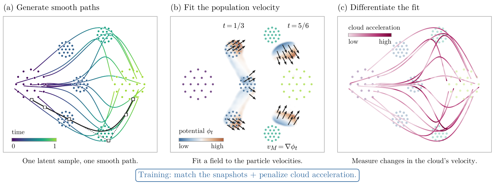
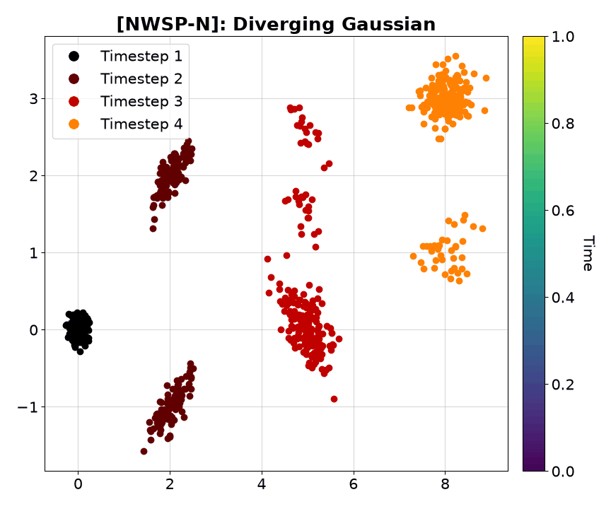

# Neural Wasserstein Splines (NWSP)

Implementation of the paper *Neural Wasserstein Splines: Representation-Invariant Second-Order Priors for Trajectory
Inference*.

**Authors:** Amartya Banerjee, Harlin Lee, Caroline Moosmüller

## Description

Population dynamics are often observed only as unpaired snapshots: in single-cell experiments, for example, the cells
measured at successive times are different cells, so the evolution between the measurements is underdetermined.
Trajectory inference reconstructs a continuous curve of distributions from such snapshots, and a dynamical prior
decides how the population moves between them. A natural prior is that the motion changes gradually (a small
acceleration), but a penalty on the accelerations of sampled particles is a prior on joint particle paths: different
particle representations of the same population curve can have very different accelerations (an isotropic Gaussian
cloud that stands still and one that rotates rigidly have the same distribution at every time).

In this work, we introduce Neural Wasserstein Splines (NWSP), a sample-based method that learns a continuous population
curve under a Wasserstein smoothness prior. A neural network maps a latent variable to the control points of a cubic
B-spline in time, so the population can be sampled at any time by evaluating the spline, without numerical integration
and without transport couplings between snapshots. The splines are fitted to the snapshots with distributional losses (a
debiased Sinkhorn divergence and an MMD). To regularise the motion of the population rather than that of individual
particles, we project the generator's velocity onto the gradients of a finite dictionary of scalar potentials by ridge
regression and differentiate this measure-dependent projection in time, including the change of its Gram matrix (the
moving-Gram term). This gives a finite-dimensional surrogate for the intrinsic Wasserstein acceleration, whose energy is
penalised during training. For a fixed dictionary and ridge parameter, the population penalty depends only on the
marginal curve, not on how the particles are paired over time (its minibatch estimate only up to sampling error). NWSP-N
adds learned neural potentials to the dictionary, trained by a separate velocity-fitting objective, to sharpen the
acceleration estimate. Both methods identify the population curve: a generator path is one particle representation of
it, not the history of an individual cell.


<p align="center">

</p>

<p align="center"><em>(a) A network maps each latent sample to the control points (squares) of a cubic spline: one
smooth path per sample. (b) A ridge regression fits a gradient field v<sub>M</sub> = ∇φ<sub>t</sub> to the particle
velocities. (c) Differentiating the fitted field along the motion gives the cloud acceleration a<sub>M</sub>, whose
magnitude colours the same paths. Training matches the snapshots and penalises the mean squared cloud acceleration;
NWSP-N also learns the potentials of (b). The example is NWSP-N fitted to the four Converging Gaussian
snapshots.</em></p>


<p align="center">

</p>

<p align="center"><em>NWSP-N on the Diverging Gaussian data: generator paths (one latent per path, colour = time) and
the four observed snapshots.</em></p>


## Installation

You can install the dependencies using either conda or pip:

### Using conda

```bash
# Create and activate a conda environment
conda create -n nwsp python=3.12
conda activate nwsp

# Update pip (old versions fail on the PyTorch package index)
python -m pip install --upgrade pip

# Clone the repository
git clone https://github.com/amartya21/Neural-Wasserstein-Splines.git
cd Neural-Wasserstein-Splines

# Install the dependencies
pip install -r requirements.txt

# Set up the Jupyter kernel
python -m ipykernel install --user --name=nwsp
```

### Using pip

```bash
# Create and activate a virtual environment
python3.12 -m venv nwsp-env   # any Python 3.10 or newer
source nwsp-env/bin/activate  # On Windows, use: nwsp-env\Scripts\activate

# Update pip (old versions fail on the PyTorch package index)
python -m pip install --upgrade pip

# Clone the repository
git clone https://github.com/amartya21/Neural-Wasserstein-Splines.git
cd Neural-Wasserstein-Splines

# Install the dependencies
pip install -r requirements.txt

# Set up the Jupyter kernel
python -m ipykernel install --user --name=nwsp-env
```

Python 3.10 or newer is required. Tested with Python 3.12, PyTorch 2.14, NumPy 2.5, SciPy 1.18, POT 0.9.7, pandas
2.3 and 3.0 and Matplotlib 3.11 on Linux. Run the snippets and `run_nwsp.py` from the repository root (the modules are
imported from there; there is nothing to install).

**GPU.** The CPU is enough for the toy, 2-D and 10-D datasets; Veres (d = 30) and CITE-seq (d = 100) are much faster on
a GPU. A 2-D fit with the paper's settings, such as Petal, is also faster on a GPU than on one CPU thread (NWSP and
NWSP-N about 4 and 5 minutes on an A100 with `--device cuda`, against 6 and 8.5 minutes), but its scores then differ
from the one-thread CPU scores (see Command Line). CITE-seq needs about 14 GB of GPU memory; on smaller GPUs use
`--device cpu`. The default Linux wheel of PyTorch 2.14 is built for CUDA 13 and needs a recent NVIDIA driver (R580 or
newer). With an older driver, torch warns "The NVIDIA driver on your system is too old",
`python -c "import torch; print(torch.cuda.is_available())"` prints `False` and everything runs on the CPU. In that case
install the wheel for your driver from [pytorch.org](https://pytorch.org/get-started/locally/), e.g.
`pip install --force-reinstall torch --index-url https://download.pytorch.org/whl/cu126` (CUDA 12.6; tested with driver
R560). For a CPU-only machine, `pip install torch --index-url https://download.pytorch.org/whl/cpu` (after upgrading
pip) before `pip install -r requirements.txt` avoids the CUDA libraries of the default Linux wheel.

## Project Structure

The repository is organized as follows:

```
Neural-Wasserstein-Splines/
├── Data/                  # Bundled datasets (sources, licences and checksums in Data/README.md)
├── figures/               # Method overview figure
├── gifs/                  # Demo animation
├── nwsp/                  # The method
│   ├── __init__.py
│   ├── model.py           # Cubic B-spline basis and the spline generator
│   ├── potentials.py      # Fixed dictionary of potentials and learned neural potentials
│   ├── projection.py      # Weak projection, its time derivative (moving-Gram term), acceleration energy
│   ├── losses.py          # Sinkhorn divergence, MMD, automatic entropic regularisation and batch size
│   └── trainer.py         # NWSPConfig, NWSPNConfig, NWSPTrainer, NWSPNTrainer, potential learning, save / load
├── data_gen.py            # Dataset loading and generation (incl. Petal), held-out splits, standardisation
├── utils.py               # Evaluation (W1, W2, MMD) and plotting functions
├── run_nwsp.py            # Command line: fit one dataset, score held-out snapshots, save the outputs
├── nwsp-demo.ipynb        # Demo notebook with examples
├── requirements.txt       # Python dependencies
├── MIT-LICENSE.txt        # License file
└── README.md              # This file
```

## Quick Start

```python
import matplotlib.pyplot as plt
import numpy as np
import torch
from data_gen import get_dataset, split_dataset
from nwsp import NWSPConfig, NWSPTrainer
from utils import evaluate_split, plot_figure

torch.set_num_threads(1)   # one CPU thread, as for the reference scores in this README

# Toy data: 5 snapshots of 256 points in 2-D at t = 0, 0.25, ..., 1; withhold the middle one
data = get_dataset('circular')
split = split_dataset(data, held_out=[2])

# Fit NWSP (small and fast settings; NWSPConfig() gives the paper's settings)
trainer = NWSPTrainer(split.train_times, split.train_frames, NWSPConfig.quickstart())
trainer.fit()

# Score the prediction at the withheld time: exact W1 and W2, MMD
scores = evaluate_split(trainer, split)
s = scores['held_out'][2]
print(f"W1 {s['W1']:.4f}  W2 {s['W2']:.4f}  MMD {s['MMD']:.4f}")   # W1 0.1446  W2 0.1579  MMD 0.0270

# Generator paths over the fitted time range, drawn with the observed snapshots
t = np.linspace(0, 1, 101)
paths = trainer.sample_paths(t, n=200, seed=0)
plot_figure(paths, t, split.frames, held_out=[2], title='NWSP: circular toy data')
plt.show()
```

This takes about 10 s. Every reference score in this README comes from one CPU thread (`torch.set_num_threads(1)`,
or `--threads 1` of `run_nwsp.py`); other thread counts can change the scores. `NWSPNTrainer` with
`NWSPNConfig.quickstart()` fits NWSP-N in the same way (held-out W1 0.1445).

## Features

- Trajectory inference from unpaired snapshots with a neural spline generator: samples and particle paths at any time
  from one network evaluation, without numerical integration or transport couplings between snapshots
- Fit term: debiased Sinkhorn divergence plus a multi-bandwidth MMD, with automatic entropic regularisation
- Second-order prior, representation-invariant (as a population quantity) for a fixed dictionary and ridge: energy of
  the population acceleration, obtained by differentiating in time a ridge projection of the velocity onto gradients of
  potentials (with the moving-Gram term); `lambda_acc = 0` gives the plain spline fit
- NWSP-N: learned potentials appended to the dictionary, trained with the generator fixed to capture as much of the
  population velocity as possible, in alternation with the generator updates
- Held-out evaluation with exact W1 and W2 (POT) and MMD, as in the paper
- float64, deterministic seeds, CPU and CUDA; save and load fitted models
- 13 datasets: three toy datasets, four synthetic benchmarks and six single-cell / simulated benchmarks (bundled)

## Documentation

### Key Classes

#### NWSPTrainer

Fits NWSP to snapshots and samples the fitted curve at any time (the defaults are the paper's settings):

```python
from nwsp import NWSPConfig, NWSPTrainer, load_model

config = NWSPConfig(
    lambda_acc=1e-4,       # weight of the acceleration penalty (0: no penalty, the plain spline fit)
    steps=3000,            # Adam steps (lr=3e-3, cosine schedule, gradient norm clipped at 10)
    warmup_steps=300,      # penalty off during the warm-up, then ramped up over ramp_frac=0.2 of the remaining steps
    width=128, depth=3,    # generator MLP (SiLU); latent dimension dz='auto' = min(d, 16)
    n_ridge=32,            # sine / cosine ridge potentials (36 built) next to the linear and quadratic ones
    ridge_reg=1e-4,        # ridge r of the projection solves
    b_fit='auto',          # points per snapshot in the fit term: min(128, smallest snapshot)
    sinkhorn_eps='auto',   # max(1e-3, 0.02 x mean total variance of the snapshots)
    seed=0,                # training seed
    device='cpu',          # 'cpu', 'cuda', 'cuda:N' or 'auto' (CUDA when available and d > 10)
)
trainer = NWSPTrainer(times, frames, config)   # times (T,), frames: list of T arrays (n_t, d)
trainer.fit()

x = trainer.sample(1.5, n=1000, seed=0)                       # (1000, d) samples at t = 1.5 (in the fitted range)
paths = trainer.sample_paths([0.0, 0.5, 1.0], n=100, seed=0)  # (3, 100, d): the same particles at three times
trainer.save('results/model.pt')
model = load_model('results/model.pt')                        # samples like the trainer (same device)
```

The other fields are `b_proj=256` and `b_loss=256` (projection and loss batches of the penalty), `n_times=2` (penalty
times per step), `sinkhorn_iters=100`, `mmd_weight=0.1`, `lr=3e-3`, `ramp_frac=0.2`, `dz='auto'`, `dict_seed=0`
(dictionary and bandwidths) and `log_every=100`. `NWSPConfig.quickstart()` gives small and fast settings for the toy
data (200 steps; the merging blobs of `converging` need `NWSPConfig.quickstart(steps=1000, warmup_steps=200)`, which
`run_nwsp.py --quickstart` uses for them). `trainer.history` holds a training record (loss, fit, Sinkhorn, MMD, penalty
weight, acceleration energy) every `log_every` steps.

#### NWSPNTrainer

NWSP-N, with the learned potentials of the paper's design. Potential updates, with the generator fixed, train the
learned potentials to capture as much of the population velocity as possible (see Objective); they alternate with the
generator steps, which treat the potentials as constants:

```python
from nwsp import NWSPNConfig, NWSPNTrainer

config = NWSPNConfig(          # all NWSPConfig settings, plus the learned potentials
    n_neural=16,               # learned potentials: tanh MLP of width nn_width=64 and depth nn_depth=2
    potential_pretrain=200,    # pretraining steps after the warm-up (lr 3e-3), then one per step (lr 1e-3, cosine)
    potential_batch=256,       # two batches of potential_batch samples at potential_times=2 times per update
)
trainer = NWSPNTrainer(times, frames, config)
```

The other fields are `nn_gamma=1.5` (scale of the first-layer initialisation), `potential_lr=3e-3`,
`potential_lr_joint=1e-3`, `potential_every=1` and `potential_refresh=25` (steps between refreshes of the feature
scales).

Times are physical times. Only the range from the first to the last snapshot is fitted: outside it the spline is
extrapolated with the cubic of its first or last span, and sampling warns. The defaults assume coordinates of order
one (the trainer warns otherwise): standardise other data first and map the samples back with `x * std + mean`
(`split_dataset` standardises the `eb_phate` splits this way; their scores and samples stay in standardised
coordinates and `split.whitening` holds the `(mean, std)`):

```python
from data_gen import standardize
from nwsp import NWSPConfig, NWSPTrainer

frames_std, mean, std = standardize(frames, retained=range(len(frames)))
trainer = NWSPTrainer(times, frames_std, NWSPConfig()).fit()
x = trainer.sample(1.5, n=1000, seed=0) * std + mean          # samples in the units of the data
trainer.save('results/my_model.pt', whitening=(mean, std))
```

### Available Datasets

The `get_dataset` function provides the datasets of the paper and three toy datasets:

```python
from data_gen import get_dataset, split_dataset

datasets = [
    'circular', 'converging', 'expanding',   # toy data of the quick start (5 snapshots of 256 points, 2-D)
    'diverging_gaussians',   # Gaussian clusters that split (4 x 200, 2-D)
    'diamonds',              # Petal (5 x 321, 2-D; alias 'petal')
    'converging_gaussian',   # ring grids that split and merge again (19, 57, 38, 19 points, 2-D)
    'circular_gaussian',     # Gaussian clouds around a circle (10 x 100, 2-D)
    'dyngen_tree',           # dyngen tree (7 x 319, 10-D)
    'dyngen_cycle',          # dyngen cycle (15 x 52, 10-D)
    'eb_phate',              # embryoid body, PHATE coordinates (5 snapshots, 2-D; standardised per split)
    'bsbm_mouse',            # mouse hematopoiesis (3 snapshots, 2-D)
    'bsbm_veres',            # Veres beta-cell differentiation (8 snapshots, 30-D)
    'citeseq',               # CITE-seq, 100 principal components (4 x 1000)
]

data = get_dataset('dyngen_tree', seed=0)    # seed: generator / subsampling seed (0 = the paper's data)
split = split_dataset(data, held_out=[3])     # withhold interior snapshot 3
```

`data.times` holds the snapshot times (0, 1, ..., T - 1 for the benchmark datasets, 0, 0.25, ..., 1 for the toy
data), `data.frames` the snapshots (arrays of shape (n_t, d)) and `data.weights` the weights of the observed points in
the scores. `split.train_times` and `split.train_frames` are the retained snapshots, `split.frames` all snapshots in
training coordinates and `split.whitening` the `(mean, std)` of a standardised split.

The toy datasets were generated for this repository. Diverging Gaussian, Petal, Converging Gaussian and Circular
Gaussian are generated by ports of the generators of the Wasserstein Lane-Riesenfeld (WLR) repository (Petal follows
[MIOFlow](https://github.com/KrishnaswamyLab/MIOFlow), Converging Gaussian follows Clancy and Suarez, 2022). The Dyngen
Tree, Dyngen Cycle and CITE-seq files come from the
[WLR repository](https://github.com/amartya21/Wasserstein-Trajectory-Inference), the mouse hematopoiesis and Veres
files from [BranchSBM](https://github.com/sophtang/BranchSBM) and the embryoid-body coordinates from
[TrajectoryNet](https://github.com/KrishnaswamyLab/TrajectoryNet). These files keep the MIT licences of their source
repositories (TrajectoryNet's at the pinned commit; a related processed CITE-seq archive, Tong 2023, is licensed
CC BY 4.0), and [Data/README.md](Data/README.md) gives their sources, licences and checksums.

### Evaluation

```python
from utils import evaluate, evaluate_split

scores = evaluate(samples, truth, truth_weights)   # {'W1', 'W2', 'MMD'}: exact W1 and W2 (POT), multi-bandwidth MMD
res = evaluate_split(trainer, split)               # the paper's protocol: held-out scores (samples drawn with seed
                                                   # 1000 + training seed) and the W1 at the retained snapshots
```

`res['held_out'][k]` holds the scores at held-out snapshot `k`, `res['retained_w1'][i]` the W1 at retained snapshot
`i` and `res['samples']` the scored samples. W1 and W2 are exact optimal transport distances between the generated
samples and the observed snapshot; `MMD` is the squared MMD averaged over Gaussian kernels with bandwidths 0.25, 0.5,
1, 2 and 4 times the standard deviation of the observed snapshot (as reported in the paper).

### Visualization

The `plot_figure` function in `utils.py` draws generator paths coloured by time with the observed snapshots on top:

```python
from utils import plot_figure, plot_snapshots

plot_figure(
    paths,              # (Q, P, d) generator paths, or None
    path_times,         # (Q,) times of the paths
    frames,             # observed snapshots, drawn on top
    held_out=(),        # snapshots drawn as hollow circles
    title='',
    figsize=(10, 8),
    alpha=0.6,
    max_paths=200,
)
plot_snapshots(frames, generated, times, held_out)   # observed (top) and generated (bottom) snapshots
```

Snapshot `i` is labelled `Timestep i+1` (as in WLR), so `--held_out 2` is drawn as `Timestep 3 (held out)`; the colour
bar shows the time of the paths.

### Command Line

`run_nwsp.py` fits one dataset, scores the held-out snapshots and saves the outputs:

```
python run_nwsp.py --dataset NAME [--method {NWSP,NWSP-N}] [--held_out K [K ...]] [--lambda_acc L]
                   [--steps N] [--seed S] [--device DEVICE] [--threads T] [--quickstart] [--held_out_only]
                   [--output DIR]
```

| option | default | meaning |
|---|---|---|
| `--dataset NAME` | required | a dataset name (above) |
| `--method` | `NWSP` | `NWSP` or `NWSP-N` (the paper's design) |
| `--held_out K [K ...]` | none | interior snapshots withheld from the fit and scored; none: every snapshot is fitted |
| `--lambda_acc L` | 1e-4 (1e-3 with `--quickstart`) | penalty weight; `0` gives the plain spline fit (the paper's weights: table below) |
| `--steps N` | 3000 (200 with `--quickstart`, 1000 for `converging`) | training steps; the warm-up keeps its share of the steps |
| `--seed S` | 0 | training seed (scored samples use 1000 + S, retained diagnostics 2000 + S, plotted paths 3000 + S) |
| `--device` | `auto` | `auto` (CUDA when available and d > 10), `cpu`, `cuda`, `cuda:N` |
| `--threads T` | 1 | torch / BLAS threads |
| `--quickstart` | off | small and fast settings (`NWSPConfig.quickstart()`), seconds on the toy data (`converging` runs 1000 steps, about 45 s) |
| `--held_out_only` | off | skip the W1 diagnostic at the retained snapshots (minutes on `bsbm_veres`) |
| `--output DIR` | `results/<method>_<dataset>[_h<k>...][_lam<L>][_qs][_steps<N>][_<device>]_s<seed>` | output directory (files in it are replaced); the optional parts appear when `--held_out`, `--lambda_acc`, `--quickstart`, `--steps` or `--device` (other than `auto`) are given |

```bash
# toy data, snapshot 2 withheld, small settings (seconds)
python run_nwsp.py --dataset circular --held_out 2 --quickstart
python run_nwsp.py --dataset circular --held_out 2 --quickstart --method NWSP-N
# Petal with the paper's settings (minutes)
python run_nwsp.py --dataset diamonds --held_out 2
python run_nwsp.py --dataset diamonds --held_out 2 --method NWSP-N
python run_nwsp.py --dataset diamonds --held_out 2 --lambda_acc 0     # plain spline fit, no penalty
# every snapshot of Dyngen Cycle with the paper's penalty weight (about 8 minutes)
python run_nwsp.py --dataset dyngen_cycle --lambda_acc 1e-6
# Veres (d = 30) on a GPU, held-out scores only
python run_nwsp.py --dataset bsbm_veres --held_out 2 --lambda_acc 1e-2 --method NWSP-N --device cuda --held_out_only
```

Each run prints the training time, the held-out scores and the output directory, e.g.

```
NWSP on Circular (toy): trained in 9.0 s; held out [2]: W1 0.1446  W2 0.1579  MMD 0.0270; retained-fit W1 0.0848
Outputs: results/NWSP_circular_h2_qs_s0  (13.6 s)
```

| command | held-out scores and retained-fit W1 | training |
|---|---|---|
| `--dataset circular --held_out 2 --quickstart` | `W1 0.1446  W2 0.1579  MMD 0.0270; retained-fit W1 0.0848` | about 10 s |
| `--dataset circular --held_out 2 --quickstart --method NWSP-N` | `W1 0.1445  W2 0.1573  MMD 0.0273; retained-fit W1 0.0847` | about 12 s |
| `--dataset diamonds --held_out 2` | `W1 0.1128  W2 0.1411  MMD 0.0161; retained-fit W1 0.0435` | about 6 min |
| `--dataset diamonds --held_out 2 --method NWSP-N` | `W1 0.1166  W2 0.1431  MMD 0.0169; retained-fit W1 0.0520` | about 8.5 min |

The output directory contains:

| file | content |
|---|---|
| `metrics.json` | held-out scores (W1, W2, MMD) and their mean, W1 at every retained snapshot, training time, the resolved settings |
| `samples.npz` | the scored samples (`generated_<i>`), generator paths (`paths`, `path_times`) and, for a standardised dataset, `whiten_mean` and `whiten_std` |
| `trajectories.png` | generator paths coloured by time and the observed snapshots (`plot_figure`) |
| `checkpoint.pt` | the fitted model (`nwsp.load_model`) |

The numbers above were obtained on one thread of an AMD EPYC 7V13 with the tested versions. Another CPU family, thread
count or library version, or a GPU, can change the rounding or the random draws; a fit there is then another random
draw of the same method, and its scores can differ by as much as between seeds, or more. For Petal (`--held_out 2`),
NWSP gives held-out W1 0.113, 0.102 and 0.101 with seeds 0, 1 and 2 on one CPU thread; both methods give 0.089 on an
A100 GPU, and NWSP-N gives 0.096 on six CPU threads. Sample a model trained on a GPU on the GPU (CPU and CUDA random
streams differ).

### Paper Settings and Selected Penalty Weights

| setting | value |
|---|---|
| generator | MLP with 3 hidden SiLU layers of width 128 plus a linear skip, latent `z ~ N(0, I)` of dimension min(d, 16); control points of a clamped cubic B-spline with knots at the fitted snapshot times (time rescaled to [0, 1]) |
| fit term | per snapshot `S_ε + 0.1 MMD²` on min(128, smallest snapshot) points; `ε = max(1e-3, 0.02 x mean total variance)`, 100 log-domain iterations; 5 Gaussian bandwidths, 0.25 to 4 times the median distance |
| dictionary | d linear + d(d+1)/2 quadratic + 36 sine / cosine ridge potentials (41 for d = 2, 101 for d = 10, 531 for d = 30, 5186 for d = 100); ridge 1e-4 |
| penalty | `λ E\|a_M\|² / L²` at 2 stratified times per step, projection and loss batches of 256; off for 300 warm-up steps, then ramped up over 20 % of the remaining steps |
| optimisation | 3000 Adam steps, learning rate 3e-3 with cosine decay, gradient norm clipped at 10, float64 |
| NWSP-N | 16 learned tanh potentials (width 64, 2 hidden layers), trained with the generator fixed by the potential-learning objective (see Objective); potential updates: 200 pretraining steps after the warm-up (lr 3e-3), then one per generator step (lr 1e-3, cosine), each on 2 independent batches of 256 samples at 2 times; feature scales refreshed every 25 steps |
| selection | λ in {0, 1e-8, 1e-6, 1e-4, 1e-2, 1} (NWSP-N on CITE-seq: {0, 1e-4}), chosen per held-out snapshot on W1 without looking at that snapshot; seeds 0, 1, 2 |

The penalty weights selected in the paper (leave-one-out: each interior snapshot withheld in turn):

| dataset (`key`) | T | d | points per snapshot | λ NWSP | λ NWSP-N |
|---|---:|---:|---|---|---|
| Diverging Gaussian (`diverging_gaussians`) | 4 | 2 | 200 | 1e-4 | 1e-4 |
| Petal (`diamonds`) | 5 | 2 | 321 | 1e-4 | 1e-4 |
| Converging Gaussian (`converging_gaussian`) | 4 | 2 | 19, 57, 38, 19 | 1e-4 | 1e-4 |
| Circular Gaussian (`circular_gaussian`) | 10 | 2 | 100 | 1e-8 | 1e-6 (1e-8 for snapshot 1) |
| Dyngen Tree (`dyngen_tree`) | 7 | 10 | 319 | 1e-4 | 1e-4 |
| Dyngen Cycle (`dyngen_cycle`) | 15 | 10 | 52 | 1e-6 | 1e-6 |
| Embryoid body (`eb_phate`) | 5 | 2 | 2381 to 4163 | 1e-4 | 1e-4 |
| Mouse hematopoiesis (`bsbm_mouse`) | 3 | 2 | 1429, 3781, 5788 | 1e-2 | 1e-2 |
| Veres beta-cell (`bsbm_veres`) | 8 | 30 | 3562 to 12477 | 1e-2 | 1e-2 |
| CITE-seq (`citeseq`) | 4 | 100 | 1000 | 1e-4 | 1e-4 |

With every second interior snapshot withheld at once (T >= 5), the choices are the same except for Veres (0 for
snapshot 1, 1e-2 otherwise), Circular Gaussian (1e-4 for snapshot 1, 1e-6 otherwise), Dyngen Tree (1e-2 for
snapshot 1, 1e-4 otherwise) and Dyngen Cycle (1e-8 for snapshots 1 and 13 with NWSP and for snapshots 1, 3 and 5 with
NWSP-N, 1e-6 otherwise). To rerun a dataset with its weight (about 8 and 11 minutes on one CPU thread):

```bash
python run_nwsp.py --dataset dyngen_cycle --held_out 4 --lambda_acc 1e-6
python run_nwsp.py --dataset circular_gaussian --held_out 3 --lambda_acc 1e-6 --method NWSP-N
```

### Objective

Time is rescaled over the fitted snapshots to `s = (t - t_first) / (t_last - t_first)` in [0, 1]. With samples
`X_s = G(s, Z)` (`Z ~ N(0, I)` fixed along a path), velocity `U = dX/ds`, acceleration `W = d²X/ds²` and the gradients
`F(x) = [∇f_1(x), ..., ∇f_M(x)]` of the potentials:

```
A = E[FᵀF],   b = E[FᵀU],                             (A + rI) c = b              (projected velocity v_M = F c)
Ȧ = E[ḞᵀF + FᵀḞ],   ḃ = E[ḞᵀU + FᵀW],   Ḟ = D_xF[U],    (A + rI) ċ = ḃ − Ȧ c        (moving-Gram term Ȧ c)
a_M = F ċ + D_xF[F c] c
loss = mean_k [ S_ε(ρ_{s_k}, μ_k) + 0.1 MMD²(ρ_{s_k}, μ_k) ] + λ E_s E|a_M(X_s)|² / L²
```

where `ρ_s` is the law of `X_s`, `μ_k` the snapshot observed at `s_k`, `S_ε` the debiased Sinkhorn divergence, `r`
the ridge `ridge_reg`, `L` the root-mean-square distance of the pooled fitted snapshots from their mean and λ the
penalty weight `lambda_acc` (reached after a warm-up and a linear ramp; the paper writes λ for the ridge `r` and λ_a
for this weight).

`S_ε` is evaluated with `sinkhorn_iters = 100` log-domain iterations per potential and one differentiable refinement
through both dual potentials: at converged potentials the gradient of the Sinkhorn term is that of `2 S_ε` (the
logged value is `S_ε`). For a small `ε` (e.g. Petal and the embryoid body) 100 iterations do not fully converge, and
the value and the gradient approximate these.

NWSP-N appends K learned potentials to the dictionary, their gradients scaled to unit root-mean-square norm. With the
generator fixed, the potential updates maximise the regularised explained velocity energy `bᵀ(A + rI)⁻¹b` (how much
of the population velocity energy the dictionary can represent), normalised by the particle velocity energy `E|U|²` and
estimated on two independent batches `j = 1, 2` (moments `A_j`, `b_j`, velocities `U_j`) at stratified times, each
batch used once to fit the coefficients and once to evaluate those fitted on the other:

```
Q(s) = (b_2ᵀ c_1 + b_1ᵀ c_2) / (E|U_1|² + E|U_2|²),     c_j = (A_j + rI)⁻¹ b_j
```

The penalty is not minimised over the learned potentials: that could favour potentials that miss the motion and so
make the measured acceleration small.

## Example Notebook

The repository includes the Jupyter notebook `nwsp-demo.ipynb` (outputs saved from a run on an A100 GPU) that
demonstrates:
- Loading and plotting the datasets
- Fitting NWSP and NWSP-N with a held-out snapshot and scoring the prediction
- Fitting every snapshot of the three toy datasets
- Petal with the paper's settings, one snapshot held out
- Sampling at and between the observed times, particle paths, saving and loading, with a model fitted to every
  snapshot of Circular Gaussian

The notebook takes about 14 minutes with an A100 GPU and about 17 minutes on one CPU thread. Its two fits with the
paper's settings (Petal and Circular Gaussian) run on the GPU when there is one; the small quickstart fits stay on the
CPU, where they are faster and print the Quick Start scores. Without a GPU, six CPU threads (`torch.set_num_threads(6)`)
are as fast as the A100 or faster. CPU and CUDA draw different random numbers, so on a GPU the Petal score differs from
the one-thread CPU score above (A100: held-out W1 0.089); other thread counts can change the scores as well.

## Citation

If you use this code in your research, please cite:

```bibtex
@article{banerjee2026neural,
  title={Neural {W}asserstein Splines: Representation-Invariant Second-Order Priors for Trajectory Inference},
  author={Banerjee, Amartya and Lee, Harlin and Moosm{\"u}ller, Caroline},
  journal={arXiv preprint},
  year={2026}
}
```

The arXiv link will be added here once the preprint is available.

## License

This project is licensed under the MIT License - see the [MIT-LICENSE.txt](MIT-LICENSE.txt) file for details. The
bundled datasets come from the sources listed in [Data/README.md](Data/README.md), which also gives their licences.
